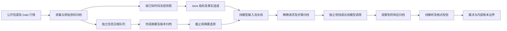

# 数据流与重放契约（0.8.0）

## 边界与纯转换

系统以“获取快照 → 纯转换 → 提交结果”组织数据流。HTTP、WebSocket、数据库、模型调用、调度器、时间及随机种子属于边界；计算函数只消费显式参数，不访问这些边界，也不修改调用方输入。网络采集和持久化本身有副作用，不能声称整个运行中的系统无副作用。

`fast_lane`、`deep_lane`、`compression_lane` 的执行槽、超时和提供商容量仍独立。新流水线没有全局工作队列或单线程锁。共享数据库只保存事实和执行记录。

## 各条数据的输入、处理与输出

| 数据 | 显式流入 | 纯处理函数 | 流出及归档 |
| --- | --- | --- | --- |
| 技术指标 | 各周期 K 线、计算截止时刻 | `IndicatorEngine.calculate`、`IndicatorReplay.calculate` | 完整 DECIMAL128 计算值、实际 K 线输入、规则版本；`research-indicator-inputs` |
| 指标研究投影 | 已冻结六周期计算结果 | `IndicatorProjection.project` | 确定列序的 CSV；原始 close/volume 保留精度，派生指标最多八位小数 |
| 官方经济发布 | 原文提取版本集合、截止时刻 | `EconomicSelection.releases` | 仅采用截止前发布、收到且已提取的版本；不同单位分开 |
| 公开经济预期 | 提供方版本、口径、单位、事件时点、统计期、截止时刻 | `EconomicSelection.expectations` | 每种确定口径一份预期及服务端选择记录；提供方自有预测与一致预期分别处理 |
| 宏观事实 | 完整 `AnalysisTypes.View` 与截止时刻 | `AnalysisProjection.project` | 驱动、发布、修订、预期、公开事实及覆盖缺口；`research-analysis-projection` |
| 已完成新闻摘要 | 冻结文章、原文哈希、选定摘要、压缩开关和截止时刻 | `NewsSummaryProjection.project` | 仅匹配原文、完整压缩且截止前完成的摘要；`research-summary-selection` |
| 研究事实与观点 | 冻结证据、匿名上轮观点、研究任务 | `ModelDataFlow.project` | 无身份/引用/控制字段的模型事实；逐步校验记录仅留服务端 |
| 请求适配 | 上述事实、冻结模型能力、预算、模型名、提供商参数与可信指令 | `InferenceRequest.prepare` | 完整 JSON 请求字符串、字节与字符预算、实际输入事实 |
| 模型输出 | 本次实际收到的 HTTP/SSE 响应、冻结协议模式 | `ModelResponse.extract/accept` | 结构化结果或明确错误；HTTP 200 不作为推理成功依据 |
| 内部模拟 | 已校验裁决、独立账户、行情和有效规则 | 现有 Java 费用/数量/报价计算；账本提交保持事务边界 | 只更新内部模拟账本及事件；重放入口没有该提交能力 |

指标发布时先在内存保留对应 K 线和原始计算值，研究冻结时精确匹配周期、计算时间、样本数、收盘截止和数值后归档。匹配不到则显示覆盖不完整，不用当前 K 线替代历史输入。现有行情原始帧归档的连续性、保留期和丢帧情况仍以运行状态为准；指标重放不等于全 tick 成交重放。

## 精确去重与数据选择

1. 同口径预期先区分统计期、单位、事件时点和是否明确映射，再比较规范化程度、预期类型、时点精度及当时已知版本。截止后才收到的预期、发布后的预期均不回填。
2. 调查一致预期与提供方自己的预测不能混用。不同来源有分歧时记录选择依据；同质量同一时点出现不同值则将该预期设为未知。
3. 买价、卖价、成交价、标记价，名义与实际收益率，日频与盘中观察均保持独立。不会对这些数值取平均或按相等数字合并。
4. 交易成本采用模拟实际使用的费用配置，保留其来源和假设；CFD 使用 Java 核验后的有效杠杆档位。原始规则保存在归档，不重复进入模型。
5. CSV 公共列提取后逐行恢复核验。保留一个实体列以保全行数，不把未知或空字符串当作零。共享列说明不使用引用 ID 或 YAML 锚点。
6. 只删除同一 AI 观点内部完全重复的叙述。不同 AI 的论点不合并，完整方案及其风险/失效条件不改写。
7. 新闻仅去除完全相同的已完成摘要；存在不同否定、条件或数值的摘要保持独立。语义相近并不足以证明重复。
8. 预算不足会归档失败并阻止发送，不通过删除指标、截掉反证或把未知费用当作零来通过检查。

## 请求和响应档案

`inference-flow` 保存一次请求的规则版本、显式构造参数、原始逻辑输入、模型事实、每步操作说明/变更字段/字符数/SHA-256、实际请求内容及校验结果。`inference-exchange` 按实际 HTTP 尝试分别保存收到的响应、状态及客户端/上游流水号。失败和预算阻止也有记录；Authorization、API Key 和 Cookie 不进入档案。

每次真实请求前写入 PREPARED，收到响应后存档，校验后写入 VALIDATED 或 FAILED。崩溃后未取得终态的记录仍显示待定，不能推断为成功。超时未取得完整响应时，仅能重放输入构造，响应结果明确显示“无完整响应”。

处理步骤中计量的是规范 JSON 字符数。完整请求另含可信指令、输出协议、模型参数及 JSON/YAML 编码，应使用预算记录中的完整客户端 UTF-8 字节和 Unicode 字符数；这些都不是模型实际 token 数。

## 只读重放接口和页面

所有接口沿用现有 Session 认证，仅 GET 读取与计算：

- `GET /api/data-flows/{id}`：一次请求的完整档案及传输记录。
- `GET /api/data-flows/{id}/stages/{stage}`：按原输入和版本重新展开某一步的完整流入与流出，不重复存储九份大快照。
- `GET /api/data-flows/{id}/replay`：比较模型事实、逐步记录及精确请求，解析归档响应并比较结果或失败。
- `GET /api/data-flows/analysis/{runId}/replay`：从冻结宏观视图重新选值并整理。
- `GET /api/data-flows/indicators/{runId}/replay`：从实际使用的 K 线重新计算各周期指标，并报告记录覆盖。
- `GET /api/data-flows/news/{runId}/replay`：从冻结文章与完成摘要重新选择下游材料。

研究页“事实计算与选值核验”查看宏观、指标和摘要选择。每个研究或压缩答案的上下文预算中，“数据流明细与重放”查看具体步骤、原始输入、模型事实、实际请求及已校验输出。页面展开或重放不发起新 AI 请求、采集、事件发布或账本更新。

重放复用当时记录的模型响应；再次调用同一模型属于新的外部执行，可能得到不同答案。未知规则版本返回不支持，缺少历史输入返回未记录，不用新版本规则或实时数据悄悄补齐。版本升级改变转换语义时必须更新版本标识并保留相应重放实现，或者明确标为不支持。

## 验证范围

回归覆盖数值精度、未知/零/空值、CSV 引号与换行、输入不变性、同输入确定性、顺序独立的对象编码、前视过滤、冲突预期、完整方案、真实客户端适配路径、200/SSE 错误、超时、档案往返和重放不触发网络/持久化。96 条历史输入另做离线尺寸及数值核对，结果见 [模型输入测量](model-input.md)。生产部署、生产新档案和真实模型整轮完成分别验收。

### 0.8.1 发布验收响应完整性

发布校验对只读 JSON GET 使用最多三次重试，同时覆盖连接中断和 HTTP 响应已经结束但 JSON 不完整的情况。每次都重新读取完整响应；连续失败仍使验收失败，不接受残缺数据。POST、研究启动、账本操作及模型请求不使用该重试器。该补丁不改变数据流水线语义或版本，0.8.0 的流水线档案可继续重放。
