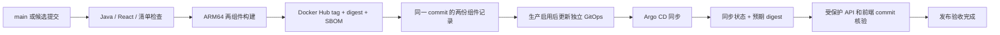

# Gold Catcher K8S 与 CI/CD 设计

2026 年 10 月 8 日核查：当前 GitHub 账号为 Prodigalgal，现有 Oracle 双区集群的两台节点均为 ARM64；Argo CD 使用独立私仓 `Prodigalgal/ircs-prod-config`。公网入口是 Cloudflare、现有 Envoy Gateway `gateway-system/mnnu-gateway`，业务 Pod 使用内部 HTTP。

Gold Catcher 源码私仓已经创建。2026 年 10 月 8 日生产 Alpha 已上线，域名为 `gold.mnnu.eu.org`，namespace、AppProject 与 Argo Application 均为 `gold-catcher`。独立登录、PoW Session、两种 Gate 行情、六周期指标和 CFD 规格/佣金签名读取已通过实际 HTTPS 验收。研究可靠性和 CFD 完整模拟仍按各自的运行证据判断。

## 仓库与运行边界

| 内容 | 位置 |
| --- | --- |
| Java、React、文档、CI、Dockerfile、初始清单模板 | `Prodigalgal/gold_catcher` |
| 生效生产配置与发布账本 | `Prodigalgal/ircs-prod-config/gold-catcher` |
| Argo 根应用注册 | `ircs-prod-config/apps/gold-catcher-application.yaml` |
| 原始凭据 | 服务器管理工作区 `private/` 与运行态 K8S Secret |
| 业务入口 | `https://gold.mnnu.eu.org`，生产 Alpha |

CI 构建镜像并更新 GitOps；Argo CD 同步 GitOps。GitHub Actions 不保存 kubeconfig，不直接修改业务资源。[Argo CD 自动同步](https://argo-cd.readthedocs.io/en/stable/user-guide/auto_sync/)

首版使用一个 Java 业务服务、一个 React 静态服务和一个 PostgreSQL StatefulSet。Java 内部各任务分开运行，但不拆成多个部署服务。内部撮合与账本首版保持单个活动实例，Deployment 使用 Recreate，避免两个版本重叠处理同一订单；后续多副本需先完成数据库租约与 fencing。

源码模板的三个工作负载副本数保持零。生产 GitOps 使用三个单副本工作负载，已由既有根应用注册；Java 和 PostgreSQL 当前部署在 `instance-20251229-0833`，Web 可独立调度。现有 any2api 与其他业务配置不在本项目发布脚本的写入范围。

## CI

`ci.yml` 在 main push 与 pull request 上检查：

1. JDK 25 / Spring Boot 4.1.0：接口鉴权、健康探针与当前阶段契约，编译并生成 bootJar。
2. Node.js 22 / React / TypeScript / Vite：按 lockfile 安装、类型检查、生产构建。
3. 发布工具：两组件必须对应同一完整 source commit，digest 格式与仓库名匹配，错误输入不修改清单，其他应用文件保持原状。
4. Kustomize 渲染：namespace、资源身份、非 root、探针、凭据引用、副本阶段与路由契约。

Java 检查覆盖实际指标、行情解析、PoW、内部撮合、费用和持久化规则。浏览器验收覆盖独立登录、会话恢复、六页面、四种屏幕宽度和真实 Gate 数据。真实 LLM 推理结果另行记录，不能用静态构建结果证明研究质量。

## 构建与发布

`release.yml` 提供 main 自动发布与手动候选构建。生产验收后启用仓库变量 `RELEASE_ENABLED=true`：相关源码变更通过质量检查后构建并提升两个镜像；手动执行 `deploy=false` 仍只构建候选。关闭该变量可暂停后续自动发布，业务运行与数据保留由生产 GitOps 控制。

完整流程如下：

ARM64 构建采用 `ubuntu-24.04-arm`；这一 runner 可用于私仓。[GitHub runner 规格](https://docs.github.com/en/actions/how-tos/write-workflows/choose-where-workflows-run/choose-the-runner-for-a-job)

两个镜像是 `docker.io/speedproxy/gold-catcher-server` 与 `docker.io/speedproxy/gold-catcher-web`。tag 带完整源码 SHA，生产清单按 `@sha256:...` 部署。两组件任一失败不提升；两份记录混用不同 commit 时拒绝提升。SBOM 与构建来源记录随镜像保留。

发布同一时间只运行一个，不取消正在进行的生产回写。回写前校验源 main；较新提交已出现时旧候选不再提升。遇到其他应用更新 GitOps 时，重新获取远端并仅重做 Gold Catcher 的镜像更新；最多三次，不覆盖远端提交。

Argo 验收核对 Healthy、Synced 和两个预期 image digest，再通过单次 PoW、CSRF 与 Session 核对 API source commit、INTERNAL_SIMULATION_ALPHA 模式、GATE渠道与前端 commit，并等待两种Gate行情和六周期指标。此验收明确对应0.3.0 Alpha；CFD完整模拟和全tick回放不在已实现能力内。

## 一次性激活

在首版业务可运行、测试和页面验收完成后执行：

1. 将本项目 `deploy/gitops/base` 与 `oracle` 作为初始配置复制到独立 GitOps 的 `gold-catcher/`。之后生产配置以独立 GitOps 为准，发布不重新覆盖业务清单。
2. 确认并创建 namespace 内 `gold-catcher-runtime` 与 `gold-catcher-registry` Secret。前者提供单人访问凭据、数据库密码、按厂商的 any2api 凭据；后者只提供镜像拉取凭据。运行密码、部署 key 与 API token 不入 Git。
3. 首次绑定数据节点并确认 Longhorn RWO 挂载；Java 与数据库尽量同节点，以降低业务查询延迟。数据库调度位置在当时资源和实际卷状态下确定，不沿用其他业务的旧节点记录。
4. 将 Java、Web、PostgreSQL 的副本数改为 1，设置首个已构建镜像 digest、源码版本、产品采集策略和正确的业务模式。增加数据库迁移与配置校验，验证单个撮合实例。
5. 将 `project.yaml` 的 AppProject 与 `application.yaml` 的 Application 模板加入 `apps/` 并登记到其 kustomization。专用 Project 只允许本 namespace 和指定 GitOps 源，`release-read` 角色只读取 Gold Catcher Application。仍由既有根 Argo 应用管理，不改变其他 Application 的同步政策。
6. 核查 Cloudflare zone 中 `gold.mnnu.eu.org` 无冲突，创建与现有 Web 入口相同的 DNS 目标，按平台约定启用代理。复用 `mnnu-gateway` 的 HTTPS 监听器与通配证书；保持 `/api` 指向 Java、其他页面指向 Web，探针不经 API 路由公开。[Gateway API HTTPRoute](https://gateway-api.sigs.k8s.io/guides/user-guides/http-routing/)
7. 配置 Gold Catcher 限定范围的 Argo 只读验收 token 和单人 HTTP 验收凭据。完成候选验收后启用 `RELEASE_ENABLED=true`，运行完整发布并保存证据。

以上一次性配置已完成。首次激活 GitOps 提交为 `ed2621c`，默认字段补齐提交为 `f2f6200`。DNS 仅新增 Gold Catcher 的四条代理记录，复用现有 Gateway 和通配证书。PostgreSQL 使用独立 10 Gi Longhorn PVC；卷保留政策不等于独立备份。

## 凭据配置

| Actions 配置 | 用途 | 本轮状态 |
| --- | --- | --- |
| `RELEASE_ENABLED`（变量） | 控制 main 自动生产发布 | 生产验收后启用 |
| `DOCKERHUB_USERNAME` / `DOCKERHUB_TOKEN` | 两个镜像的推送权限 | ARM64 两镜像构建和推送已成功 |
| `GITOPS_DEPLOY_KEY` | 独立 GitOps 仓库的 SSH 写入 | 已注册 Gold Catcher 专用写入 key，私钥只进入 Actions Secret 与本地私密目录 |
| `ARGOCD_READ_TOKEN` | 获取本应用的同步、健康与 digest | 已配置专用角色；验证读取其他应用被拒绝 |
| `GOLD_SMOKE_USERNAME` / `GOLD_SMOKE_PASSWORD` | 验证受保护的版本接口 | 已配置，走与浏览器相同的 PoW 和 CSRF 流程 |

Actions 日志与制品只包含版本、digest、构建身份和脱敏状态。验收请求使用 `GoldCatcher-release-check/0.3` User-Agent，避免 Cloudflare 对默认脚本客户端的拦截。any2api 通道策略与凭据分别配置，生产调用集群内服务 `any2api-server.any2api.svc.cluster.local:8080`，密钥只由 Java 服务读取；前端构建没有 any2api token。

Gate Key 保存在服务器管理的 `private/gold-catcher/gate.env`，生产运行配置与 Argo 只读 token 分别位于同目录的 `runtime.env`、`ci-acceptance.env`。文件权限限制为当前 Windows 用户，运行时以 Secret 注入。CFD 后台只允许签名 GET 查询 `detail` 和 `commissions`。校时失效时每 15 秒尝试恢复，有效时每 3 分钟校准；CFD 规格成功后每 5 分钟更新，失败后 30 秒重试，等待校时不会消耗签名请求。

## 数据、监控与回滚

业务账本和恢复游标持久化到 PostgreSQL。Pod 重启不增加虚拟本金，不重复费用或内部成交。数据库迁移采用向后兼容的新增字段与分阶段变更，破坏性迁移不与普通镜像回滚混在一起。

PostgreSQL 使用 Longhorn PVC；scale 与删除控制器时保留 PVC，Namespace、StatefulSet 和数据声明加入 Argo 保留政策。卷快照不替代经过恢复验证的数据库备份。备份保存到与业务卷不同的持久位置，频率在原始 tick 留存与容量预算确定后配置。

监控包括进程、DB、行情缺口、源延迟、最新有效研究、any2api 推理与上下文失败、队列、内部撮合滞后、账务校验和费用结算。Prometheus 的应用健康与有效研究分别展示；LLM 停顿不阻断报价和既有退出规则。

回滚在独立 GitOps 恢复上一份已验收的两个镜像 digest 和相应配置，并等待 Argo 与 HTTP 版本核验。保留 source commit、CI run、组件 digest、GitOps commit、Argo 状态、验收时间和结果。暂停服务通过 GitOps 修改任务开关与副本，保留 PVC；不以手工 scale 充当持久停机，也不删除既有订单和数据。
