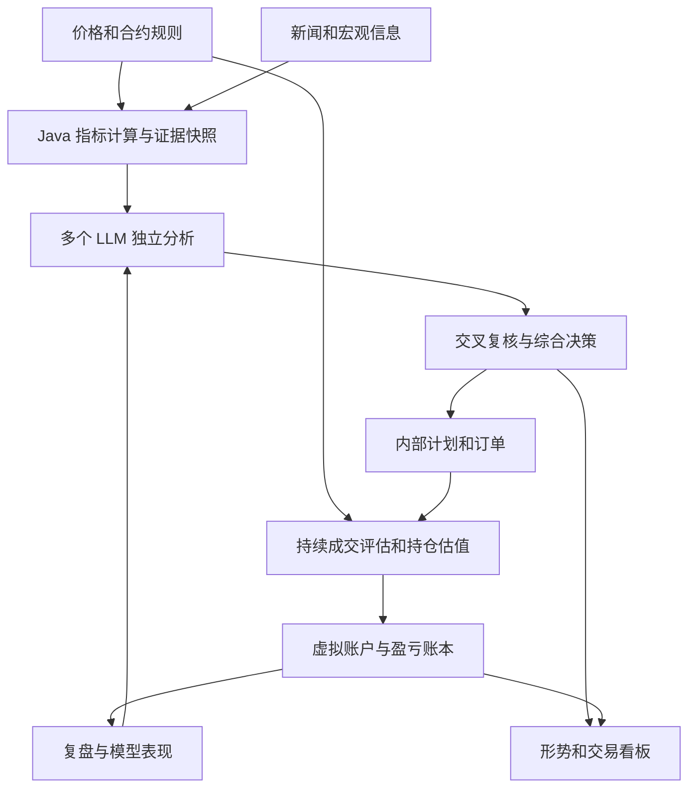

# Gold Catcher 黄金分析与内部交易模拟设计草案

设计日期：2026 年 10 月 8 日。

本版纳入 any2api 接入、信源及时性、Java 与 React 技术栈、计算精度，以及 AI 讨论中的顺序偏差与上下文限制。

Gold Catcher 持续收集影响黄金的信息和价格数据，计算量化指标，由多个 LLM 独立判断并交叉复核，在内部生成和管理模拟订单。系统用后续收到的行情评估是否具备成交条件，计算持仓、费用与盈亏，并积累可复盘的判断记录。本文确定首版需求、模块职责和模拟规则；技术选型与运行频率是可调整的设计值。

## 目标与使用范围

| 项目 | 设计约定 |
| --- | --- |
| 产品 | Gate XAU_USDT 黄金永续、Gate XAUUSD 黄金 CFD |
| 分析范围 | 重点覆盖数分钟至两天，同时使用更长周期的信息理解市场形势 |
| 资金参考 | 每笔约 100U 保证金，允许参考资金全部亏损；具体风险由 LLM 动态评估 |
| 杠杆 | 按实际产品和仓位档位选择，覆盖可用的高杠杆范围 |
| 盈利目标 | 由 LLM 按当前行情决定；不固定涨跌幅、利润金额或统一盈亏比 |
| 盈利评价 | 观察扣除交易成本后的收益，盈利单与亏损单全部进入统计 |
| 订单执行 | 创建、修改、撤销、成交和退出都在内部模拟账本中进行 |
| 外部连接 | 读取行情、产品规则、新闻和宏观数据，调用 LLM |
| LLM 接口 | 统一经过现有 any2api，按厂商、模型和实际通道管理能力与上下文预算 |
| 技术栈 | Java 后端、React 与 TypeScript 前端；价格计算和账务由后端统一负责 |
| 指标计算 | 各类投资与交易指标统一由 Java 计算，LLM 解释指标并提出策略，React 展示后端结果 |
| 信息时效 | 按信源发布方式分级采集，记录采集延迟、覆盖缺口与决策时的新鲜度 |
| AI 讨论 | 独立首轮、匿名复核、顺序轮换和同步提交；全程保留证据版本与输入预算 |
| 自动化范围 | 内部出单和管理无需逐笔人工确认 |
| 当前阶段 | 0.3.0 内部模拟 Alpha：Gate 公共行情、指标、官方信息、多模型研究和永续账本已实现；CFD 成交等待规则与费用 |

约 100U 是操作参考，不作为写死的程序常数。LLM 可以建议降低仓位、承担更大比例的单笔风险、等待或不出单。系统不增加统一的盈利百分比、止损百分比、最低胜率或最低盈亏比门槛。

系统仍需遵守模拟市场的实际条件：有限虚拟资金、合约数量与价格精度、可用杠杆、保证金规则、交易时段和订单语义。违反这些条件的提案记录为不可执行，不通过修改结果使其成立。

## 产品分别建模

黄金信息和宏观判断可以共用，产品行情与模拟账本分别处理。

| 内容 | XAU_USDT | GATE:XAUUSD |
| --- | --- | --- |
| 产品性质 | USDT 结算的黄金永续 | 黄金 CFD |
| 行情来源 | Gate Futures WebSocket / REST | Gate 官方 TradFi REST 报价与 K 线 |
| 产品规则来源 | Gate contracts、risk_limit_tiers 及公开 Taker 费率 | Gate symbols/detail 与 symbols/commissions；需要只读 Key |
| 持仓成本 | 交易手续费和资金费 | 点差、适用佣金和隔夜费 |
| 模拟成交依据 | 买卖报价、公开成交与可用盘口深度 | 对应服务器的 Bid、Ask 和订单执行规则 |
| 保证金与强平 | 按选定永续保证金模式及档位计算 | 按虚拟 CFD 账户净值和占用保证金计算 |
| 数据不可用时 | 保留状态并标记数据缺口 | 不用 XAU_USDT 报价替代 CFD 成交价 |

产品数据使用 [Gate 官方 API v4](https://www.gate.com/docs/developers/apiv4/en/)。CFD 的公开报价、K 线、产品列表均无需运行 MT5；私有规格和佣金接口需要 Key。

启动和定时刷新时读取实际产品规格，记录规则生效时间。不能把某个品类的最高杠杆当成所有黄金产品、所有仓位的可用杠杆。XAU_USDT 的杠杆、数量精度和保证金档位以当前接口结果为准；CFD 同时考虑具体 symbol 和曝光规模。

## 整体结构



首版采用 Java 与 Spring Boot 模块化单体、PostgreSQL 业务账本，以及 React、TypeScript 和 Vite 构建的 Web 看板。后端模块包括行情适配、信息采集、特征计算、研究编排、any2api 客户端、内部模拟、账本、复盘和查询接口。框架版本在实现时按兼容性锁定，不把其他项目的版本号直接当作本项目已验证的依赖组合。

行情处理、信息采集和模型推理使用独立执行资源及有界队列，LLM 请求不能阻塞报价处理。每个账户的订单和账务变更串行处理；订单更新、成交、账户变化和事件游标在同一数据库事务中保存。首版不要求拆成微服务，也不依赖新增消息中间件才能运行。

React 通过后端 REST 查询快照，通过 SSE 接收有版本和游标的行情摘要、研究进度、订单与账户变化。前端断线后重新取一致快照，再接续增量；页面刷新频率与后端逐事件模拟频率分别设置。图表可以合并渲染更新，后端成交评估不能因此丢掉 tick。

CFD 通过 Gate 官方 TradFi API 直接接入 Java。公开行情已接通；details 与 commissions 需要只读 Key。主系统的采集、指标、LLM、模拟和账务都使用 Java，不配置 MT5 终端。

高频原始数据保存为分段压缩文件，PostgreSQL 保存索引、分析快照、订单和账务记录。保存周期和数据容量可配置；不能先删除订单复盘必需的数据，再保留无法解释的历史利润。

## any2api 接入与上下文预算

### 接口与密钥配置

LLM 推理统一经过 `D:\WorkSpace\Project\ai\any2api` 对应的网关。Java 后端封装客户端，保存明确的 provider、model、路由、请求标识和实际响应模型；综合讨论不使用随机模型路由，避免无法知道参与者或悄悄更换模型。

本次核查确认 `D:\WorkSpace\Project\服务器管理\private\any2api\distribution\api-keys.env` 和 `api-keys.json` 存在。环境配置包含 `ANY2API_BASE_URL`、`ANY2API_PUBLIC_BASE_URL` 及厂商独立的 `ANY2API_<PROVIDER>_API_KEY`、相应 BASE_URL。配置文件存在不能证明密钥仍有效或对应模型当前可调用。

实现时由运行环境向 Java 后端注入所选配置，按已有厂商授权范围调用；日志、数据库中的调用记录与导出的复盘材料移除 Authorization 等凭据。React 只访问本系统接口，不接收 any2api key，不将其放进前端环境变量或浏览器存储。文档只记录配置位置和变量名。

当前本地代码提供 `/v1/chat/completions`、`/v1/responses` 及厂商前缀路由；模型目录提供 `/v1/models` 和厂商目录，模型详情包含能力与参数适配信息。首版优先采用明确模型的 Chat Completions 调用，每个讨论阶段创建独立请求；URL 是否已经含厂商路径或 `/v1`，以及 model 是否已含厂商前缀，以所选目录返回值验证，不能重复拼接。

启动、配置变更及周期刷新时读取模型目录和详情，保存 `available`、`runtime`、`capabilities`、`supported_parameters`、`parameter_adaptation`、`token_limits` 的快照。目录可访问、可用状态、探针结果、实际分析成功与结论有效分别统计；切换模型或通道后重新匹配预算，不能沿用上一条路由的能力假设。

### 已核实的限制及其含义

以下依据 2026-10-08 的本地工作区代码，包括尚未提交的内容；不据此宣称线上部署版本已一致。

| 限制 | 当前代码行为 | Gold Catcher 的处理 |
| --- | --- | --- |
| token 上限 | 按有效的 `max_input_tokens`、`max_output_tokens`、`max_context_tokens` 检查；缺失值可能不检查 | 缺失标记 UNKNOWN，使用保守配置及实测证据，不解释为无限 |
| 请求预检估算 | 原始 JSON 的 UTF-8 字节数除以 3、向上取整，作为输入估算 | 对实际序列化请求复现该检查，同时保留真实 tokenizer 或通道估计 |
| 返回 usage | 可能来自上游，也可能估算；当前回退估算按 UTF-8 字节数除以 4 | 保存 `usage_source`、`raw_usage` 与归一化用量，不用返回估算反推可发送容量 |
| 消息条数 | `truncation:auto` 默认按 32 条消息处理，也可采用模型配置；工具组完整性可能扩展保留范围 | 消息数与 token、字符、字节预算分别检查；不能把 32 当成 token 限额或统一轮数上限 |
| Web 桥接字符限制 | 部分适配器声明 `input_character_limit`，可能标记 `token_limit_verified:false` | 字符数按通道定义计量，不将其换名为已验证 token 上限 |
| 输出长度参数 | 是否支持与是否强制执行由适配器决定，部分是非强制提示 | 预留输出容量，检查终止原因和完整 JSON；截断或未完成的提案不得直接执行 |
| 请求体大小 | 网关、代理或上游可能返回 413 | 保存字节数与错误来源，不能仅凭 413 判定模型上下文 token 最大值 |

本地依据：[请求限制检查](<D:/WorkSpace/Project/ai/any2api/backend/src/main/java/com/any2api/provider/ModelRequestLimitGuard.java>)、[消息窗口处理](<D:/WorkSpace/Project/ai/any2api/backend/src/main/java/com/any2api/protocol/SmartContextWindowManager.java>)、[Web 参数适配](<D:/WorkSpace/Project/ai/any2api/backend/src/main/java/com/any2api/provider/WebParameterAdaptation.java>)、[用量归一化](<D:/WorkSpace/Project/ai/any2api/backend/src/main/java/com/any2api/protocol/UsageNormalizer.java>)、[模型目录](<D:/WorkSpace/Project/ai/any2api/backend/src/main/java/com/any2api/api/openai/ModelsController.java>)。

同日的[本地压测报告](<D:/WorkSpace/Project/ai/any2api/docs/reports/PROVIDER_LIMITS_AND_TURNS_BENCHMARK_2026-10-08.md>)和结果文件用于选择初始探测范围。成功样本只证明对应请求曾完成，不证明最大容量、多轮质量或稳定性。当前压测结果未保存 `usage_source`，其中命名为 actual 的 token 字段不能直接认定是真实 tokenizer 数量；报告中的推测容量不作为硬编码上限。

### 预算与证据压缩

每个 provider、model、模式和路由有独立预算档案，包含声明上限、已验证请求规模、计量单位、消息数与字节限制、输出参数执行方式、延迟分布、验证时间及网关版本。目录声明、管理员覆盖、网关估算和实测结果保留不同来源；经验安全预算低于已发现的失败边界，并保留可配置余量。

每次发送前分别验证输入上限、输出上限、输入加预留输出的上下文上限，以及消息、字符和请求体大小。额度已知时遵循：输入预算 + 预留输出 + 未计入输入的桥接开销 + 安全余量 ≤ 该通道上下文预算。原始 JSON 已含的指令或字段不重复计入开销；无法测定的桥接开销明确为假设。

不持续追加整段历史聊天，也不把所有新闻全文塞进模型。每阶段重新组装有版本的证据包：

1. 任务、输出结构、证据截止时间及产品单位。
2. 当前账户、仓位、有效订单、保证金、费用规则和数据缺口。
3. 多周期指标摘要、价格状态及其时间。
4. 相关事件、发布时间与首次获取时间、来源引用、反证和未知事项。
5. 当前阶段需要的匿名观点、分歧、计算校验结果与修改差异。

原文保存在证据库，按事件和引用定位。讨论各参与者共享同一核心证据包；需要补读时由编排器从同一截止时间内取资料，补充给该阶段的所有参与者，或标记为独立探索结果，不把不同信息条件当成公平对照。

先压缩重复文字、无关原文和旧讨论，保持事实、数值、引用、反证、持仓、费用与时效信息。保存摘要版本、输入哈希、被省略内容及证据覆盖率。核心证据仍放不下时减少本轮议题或换合适模型；缺少执行所需信息时返回 WAIT 或 CONTEXT_INSUFFICIENT，不能静默删除关键条件继续出单。

默认由客户端主动构造上下文，不依赖网关自动裁剪。上下文错误只做有界的重新组装与重试，并记录具体删减；重试必须仍在研究截止时间内。输出格式修复、工具续接同样计入完整请求预算，不无限累加消息。推理文本的长度不作为论证质量或投票权依据。

## 行情和信息采集

具体来源、新闻快讯、官方公告、事件日历、接入优先级与时效限制见[信源目录](source-catalog.md)。来源目录按数据通道登记，实际运行覆盖与文档发现状态分别记录。

行情至少记录 Bid、Ask、Last、Mark、Index、报价数量、产品状态以及交易所时间。缺失字段保留为空，不能用零填充。不同价格各有用途：可成交买卖价用于成交和退出估值，Mark 等适用价格用于保证金和强平检查。

XAU_USDT 使用官方 futures.book_ticker 和 futures.tickers；REST 补充 contracts、risk_limit_tiers、candlesticks 和 funding_rate。盘口原生尺寸为合约张数，Java 使用 quanto_multiplier 统一到基础 XAU 数量。每一报价数量在内部订单间共享，重连、迟到、重复和断档分别处理。[官方 WebSocket](https://www.gate.com/docs/developers/futures/ws/en/)

CFD 使用官方 GET /tradfi/symbols/XAUUSD/tickers 的 Bid/Ask 和 /klines。响应 timestamp 是服务器响应时间，不能当作最后一次 tick 时间；接口不提供可见数量或完整 tick 流。当前以 REST 快照进行形势研究，不能补造两次查询之间的触发和成交。[官方 CFD API](https://www.gate.com/docs/developers/apiv4/en/cfd/)

黄金信息按影响路径整理：

| 类别 | 信息内容 | 分析用途 |
| --- | --- | --- |
| 货币政策 | 利率决议、政策声明、央行讲话 | 判断政策预期和利率变化 |
| 经济数据 | 通胀、就业、增长及事前预期 | 区分数据本身与超预期程度 |
| 关联市场 | 美元、实际收益率、黄金相关行情 | 检查解释是否得到市场反应支持 |
| 突发事件 | 地缘、金融稳定、贸易与能源事件 | 形成事件情景，观察风险偏好变化 |
| 慢频背景 | 黄金 ETF、央行需求、持仓统计 | 辅助较长周期形势，不冒充分钟级新信号 |
| 产品交易状态 | 资金费、盘口、交易时段、保证金规则 | 判断具体产品的交易成本和可执行性 |

每条信息保存原文或允许保存的内容、来源 URL、发布时间、首次获取时间、修订版本及事件标识。转载合并为同一事件，互相引用的文章不计为多条独立证据。缺失的事前预期标记为未知，不能由 LLM 补成已发生的事实。

日频或延迟更新的数据注明频率与新鲜度，不用作实时美元或收益率报价。数据源、授权、预期值提供商和新闻覆盖范围通过配置确定。

宏观历史回放使用当时已发布的版本。ALFRED 可查询历史时点已知的数据，不能直接拿今天修订后的值回填过去。[FRED 与 ALFRED 数据版本](https://fred.stlouisfed.org/docs/api/fred/realtime_period.html)

### 采集频率与及时性

采集优先使用合法可用的推送或流式接口；轮询按来源频率、接口额度、授权和实测延迟设置。下表是首版调度目标，不能据此宣称所有来源均能达到相同速度。

| 来源类型 | 采集方式与初始频率 | 时效处理 |
| --- | --- | --- |
| 永续行情 | WebSocket 连续接收，断线后按接口能力补缺 | 按事件立即处理；监控报价年龄、序号断层和收到后的处理延迟 |
| CFD tick | 约 100–500 毫秒读取新增序列，按终端能力调整 | 统计终端到 Java 的延迟和漏 tick；不把反复读到同一报价当新数据 |
| 关键突发新闻 | 有推送则即时消费；许可轮询源目标 5–15 秒，必要时按额度加速 | 区分新闻发布延迟和本系统采集延迟，慢源不能冒充即时来源 |
| 官方重要经济发布 | 使用实际发布日历；事件前后切换高优先级，许可时约 2–10 秒检查更新 | 数据未发布时保持等待；夏令时、临时改期和修订单独处理 |
| 常规新闻、公告与 RSS | 通常 30–60 秒；来源更新慢或额度较低时相应放宽 | 增量拉取、条件请求和去重；保留来源实际能力 |
| 实时关联市场 | 有授权的流式报价；否则按来源能力轮询并注明延迟 | 日频数据不能充当实时美元或实际利率信号 |
| 慢频宏观、ETF 与持仓统计 | 按公布计划拉取，小时级、日级或周级刷新 | 到预计发布日期检查更新；显示数据日期、版本与是否延迟 |
| 产品规则、交易时段与费用 | 启动及定时刷新，公告或状态变化时立即复核 | 保存生效版本；公告费用与实际已结算费用分别记录 |

每个来源配置负责人、采集方式、正常与事件期频率、配额、预期发布时间、最大可接受年龄、重试和断线策略。退避、限流和熔断不能造成无声停采；运行页显示下次计划、最后成功、当前退避与覆盖缺口。来源失效后可以转用备用源，但保留其不同延迟与授权条件。

衡量完整链路：来源发布时间 → 首次收到 → 提取完成 → 研究触发 → 决策完成 → 内部订单生效。分别统计 p50/p95 延迟、事件漏采、重复率和过期引用率。无法取得可靠发布时间时将来源延迟标为未知，不伪造毫秒级测量。系统内接收后的处理延迟另用单调时钟计量，监控本机时间漂移。

重大事件首次到达后立即排入研究，不等待下一次定时轮询。采集层负责把新增信息及时送达，研究层按相关性和事件合并触发调用；高频抓取不意味着每条转载都调用全部模型。

## 时间规则和分析快照

每条数据保留 event_time、published_at（适用时）、received_at、extracted_at 和来源内序号；每次分析保留 evidence_cutoff、research_started_at、decision_completed_at，每个计划另记 activated_at。内部存储统一 UTC，用户界面显示北京时间 UTC+8；CFD 的交易时段与 swap 日期按服务器规则转换。

LLM 只能读取 evidence_cutoff 以前已经获取的信息。后来收到的旧时间事件可补充历史分析，但不能追溯改变实时模拟成交、原决策或账务。

订单最早生效时间为创建时间加模拟提交延迟；LLM 输入快照时刻不等于订单创建时刻。模型在思考期间出现的行情不能被倒填为已成交。

指标同时提供已收盘 K 线和最新价格。使用未收盘 K 线时明确标记，历史指标不得读取该 K 线结束后才能知道的高低点。

## 量化计算

所有投资与交易指标由 Java 后端的指标引擎计算，包括常见技术指标、自定义多周期特征、盘口指标、事件数据的数值对比，以及交易成本、保证金和盈亏指标。LLM 使用计算结果解释形势、评估风险和提出策略；React 使用同一结果展示图表和详情。模型可以提出需要观察的指标或参数，由 Java 计算后返回，不用模型生成的近似数字填充正式指标。

| 特征 | 首版计算内容 |
| --- | --- |
| 价格变化 | 多个时间窗收益、加速度、近期高低点和距离 |
| 趋势 | SMA、EMA、MACD、ADX 与 DI、均线斜率、多周期一致或冲突 |
| 动量 | RSI、Stochastic K/D、ROC，超买超卖状态与动量变化 |
| 波动 | TR、ATR、ATR 比例、Bollinger Bands、实现波动、异常波动和近期回撤 |
| 价格结构 | Donchian 通道、版本化支撑阻力、突破与回踩、区间位置 |
| 流动性与量价 | 点差、盘口深度与失衡、可用报价量、成交量变化；数据适用时计算 VWAP 与 OBV |
| 产品特征 | 永续资金费、持仓量、标记价偏离；CFD 的报价和隔夜成本 |
| 交易经验 | 同类历史计划的净收益、回撤和先到止盈或止损的频率 |

每个数值带时间窗、单位、输入来源和可用性。CFD 缺少可比成交量或深度时，只使用已有的报价信息，不能把 tick 数当作整个黄金市场的真实成交量。

数分钟至两天是关注范围，日线及更长时间的数据可以作为背景。同一时点可以同时出现较长周期偏多和短周期偏空；必须分开记录情景和适用周期。

### Java 指标引擎规范

指标引擎以产品、行情来源、周期、参数和算法版本为计算键。基础 K 线覆盖 1 分钟、5 分钟、15 分钟、30 分钟、1 小时、4 小时与日线；具体启用周期及窗口由配置决定。报价、成交、K 线和账户事件分别触发相关指标，采用增量更新与缓存，不每个 tick 全量计算所有窗口。

| 指标组 | 必须固定的计算口径 |
| --- | --- |
| SMA、EMA 与 MACD | 输入价格类型、窗口、EMA 的初值与平滑系数、快慢线和信号线参数；MACD 柱值是否乘 2 明确标注 |
| RSI、ATR、ADX 与 DI | 采用的平滑方法和初始化过程；首版采用明确的 Wilder 口径，保留预热区间 |
| Stochastic K/D 与 ROC | 高低价窗口、平滑次数、基准价格和百分比单位；窗口极差或基准为零时返回规定状态 |
| Bollinger Bands | 中轨窗口、标准差倍数、总体或样本标准差定义，以及带宽与位置的公式 |
| Donchian 与支撑阻力 | 窗口、是否排除当前进行中 K 线、识别算法和确认时点；需要后来 K 线确认的结构只在确认后可用 |
| VWAP 与 OBV | 真实可用的成交量单位、会话或锚点、输入价格；无适用量数据时为 UNAVAILABLE |
| 实现波动与相关性 | 收益定义、采样频率、是否年化、年化基准、时间对齐和缺失样本处理 |
| 盘口与点差指标 | 报价来源、盘口版本、深度范围、数量单位和计算时点；不跨产品拼接盘口 |
| 事件数值对比 | 实际值、发布前预期、前值及其版本、单位；预期缺失时不能制造“超预期”数值 |
| 风险与收益指标 | Java 根据候选数量、杠杆、价格情景和费用计算金额、保证金回报、敞口和回撤，供 LLM 评估与选择 |

保存指标值、输入截止时间、有效样本数、参数、算法版本和状态。状态至少包括 VALID、WARMING_UP、STALE、GAP、UNAVAILABLE；样本不足、停市、断线或公式分母为零不能用零值冒充有效信号。已收盘指标与进行中指标分开，Java 明确计算哪些特征可用于当前决策。

历史 K 线修订或补缺后，Java 可以重算对应指标版本；先前决策仍引用原快照。实时增量结果须与同一输入的全量重算一致，差异只能处于已声明的算法误差范围。后续增加指标通过同一注册与版本机制，不另建前端或 LLM 计算口径。

### 数值精度与计算归属

价格、数量、合约乘数、费率、保证金、资金现金流和盈亏使用 Java `BigDecimal`，从接口的十进制字符串直接构造；PostgreSQL 使用经过范围设计的 `NUMERIC`。数据库精度不能悄悄将合法产品数量截断。金钱与订单值经 JSON 以十进制字符串传输，React 不用 JavaScript Number 重新计算账务或保证金。[BigDecimal 精度与舍入](https://docs.oracle.com/en/java/javase/25/docs/api/java.base/java/math/BigDecimal.html)、[PostgreSQL 精确数值](https://www.postgresql.org/docs/current/datatype-numeric.html)

每个产品配置价格 tick、数量步长、合约单位、币种精度和舍入规则。报价先按其真实单位入库；数量转换与费用按对应规则处理，未核实的舍入规则保留假设等级。提案的数量归整结果返回给 LLM，不能静默向上扩大仓位。内部计算保留足够精度，只在规定的账务或展示边界舍入，并记录差额。

均线、ATR、收益和常规指标默认使用十进制计算；涉及对数、统计拟合等数值算法仍在 Java 内计算，可以使用独立的浮点数值模块，明确算法、误差界与不可用情况。分析近似值不能直接成为收费、成交价或保证金账务值。LLM 的数值是提案，由 Java 独立计算校验，不让模型负责最后的记账算术。

每个指标定义公式、初始化窗口、已收盘或进行中状态、缺失值规则、单位与算法版本。同名指标不能在前后端分别实现不同口径；前端图表只将后端结果转为绘图坐标，悬浮信息和账务详情显示后端原值。

账本按原币种核对现金流、持仓数量、已实现盈亏与净值；显示 USD、USDT 或汇总 U 时注明币种和换算时点。LLM 置信度、杠杆、保证金回报率和标的涨跌幅分别展示，不能混用单位。允许亏损全部参考保证金，也不能掩盖实际账户规则下的更多资金消耗。

## LLM 决策与风险评估

首版采用三个可配置的模型，通过 any2api 接入，优先来自独立供应商。模型、供应商、模型版本、提示词版本、输入快照、调用耗时和费用分别保存，不把网关地址不同误认为底层模型不同。初始选择依据实际通道的有效分析、结构化结果、延迟与预算，不仅依据模型名称或目录可用状态。

### 讨论阶段与顺序偏差

讨论是一组有边界的分析阶段，默认独立首轮加一轮交叉复核，随后综合决策。首轮输出在截止前密封收集，不让先完成的意见提前暴露给其他模型。

| 阶段 | 参与者看到的信息 | 输出与控制 |
| --- | --- | --- |
| 独立首轮 | 相同核心快照、时点、账户与任务，各自新请求 | 同时启动，独立提交方向、反证、风险和提案；不读其他模型答案 |
| 匿名交叉复核 | 首轮全部有效观点及统一的计算校验结果 | 隐去厂商、声望和耗时；按可复现顺序分配，检查事实与执行条件 |
| 同步修订 | 同阶段获得的意见和证据，固定本轮截止时间 | 各模型有相同修订机会，提交保留、修改或撤回及其理由；无无限接龙 |
| 综合决策 | 完整匿名修订集合、分歧和计算结果 | 用新的上下文按事先定义的标准裁决，保留少数意见及 WAIT 的理由 |

匿名化只移除参与者身份，不移除证据来源。详细审计保存真实模型映射。首轮不强迫模型扮演多头或空头，避免角色直接替代判断；交叉复核时可分配事实、反证、执行与风险检查职责，轮换职责，不让某个模型长期只负责为另一方背书。

处理前位与后发优势的具体规则：

- 各模型在同一阶段使用相同 evidence_cutoff。更晚返回的模型不能独享后来到达的行情或新闻；重大新证据触发新一轮，旧轮标记过期或被替代。
- 匿名观点的展示顺序按种子打乱，并在重复评估中轮换首位与末位；记录每个参与者实际阅读顺序，避免总是把同一模型放在最前或最后。
- 观点长度与引用格式有统一预算，防止较长答案挤掉反方或尾部观点。共同核心包按本轮最小可用预算组织；模型预算不足时明确缺席或降级，不提供残缺材料却计为等价投票。
- 交叉复核结果在阶段结束后一起发布，所有有效参与者再获得同样的修订材料，避免最后发言者看到前人的修订而无需接受反驳。
- 综合模型通过新请求评价匿名提案，不把自己的首轮方案当默认答案；保留全部首轮原始结果。综合结论必须指出采纳和未采纳理由，不能以模型品牌、文本长度或多数同意代替事实与盈亏核算。
- 截止后到达的结果单独归档，不倒填已经完成的主决策。复盘统计位置、角色、修订幅度、不同意见被采纳情况；用对照研究检验顺序敏感度，而不是宣称随机化已消除所有偏差。

如果同一个模型承担综合职责，其已有观点造成的偏差仍需在评价中注明。后续可以配置独立裁决模型或交叉裁决对照；首版不为追求所有模型一致而继续无界讨论。

LLM 可以决定买卖方向、是否出单、仓位和杠杆、入场方式、止盈止损、持有时间、失效条件，以及后续撤单、修改或退出。未设置价格止损的方案需要声明退出政策和接受的风险，内部仍模拟资金费、保证金变化和强平。

风险评估至少说明事件风险、波动与流动性风险、杠杆和资金风险、信息不确定性、预期盈利与亏损情景。程序用同一合约规则核算数值并将结果返回给 LLM，保存模型的估计与实际计算差异。

允许出现很小的预期净利润，不设置统一利润门槛。LLM 应解释扣除费用后的预期结果及其不确定性。预期净收益为正不能被记录为已赚到利润。

模型自报信心是意见，不直接作为交易成功概率。概率类输出标记为模型估计或统计校准值；未校准时不得展示为经验证的胜率。

默认至少两个模型成功提供有效结果，综合决策才进入主模拟账户。模型不足、事实未解决或结论过期时可保留单模型的独立研究记录，主决策标记为 LOW_QUORUM、DISPUTED、EXPIRED 或 WAIT。已有持仓按原来已生效的退出规则继续管理。

新闻与网页内容作为证据输入，模型只通过应用提供的分析接口读取资料。模型提案不直接调用交易接口、读写凭据或改账本。

上下文、调用截止时间和数据时效属于系统运行条件，区别于交易风险偏好。LLM 决定风险承担和获利目标；程序负责保证提案信息齐全、数字可核算、对应当时行情且符合模拟产品规则。

## 交易计划和内部订单

一个交易计划说明交易意图，可以包含多个分批订单及相应退出规则。主组合内，对同一机会建立唯一标识，避免每次分析重复开出同一笔仓位。

| 字段组 | 必需内容 |
| --- | --- |
| 身份 | plan_id、版本、产品、供应商和综合决策记录 |
| 时效 | 创建时间、生效时间、订单有效期、预计持有时间 |
| 动作 | WAIT、CREATE、AMEND、CANCEL、REDUCE、CLOSE |
| 交易内容 | BUY 或 SELL、订单类型、报价币、保证金币、结算币、数量单位、杠杆、保证金模式 |
| 入场条件 | 限价或触发价、触发价格类型、行情条件和事件条件 |
| 退出条件 | 固定目标、分批退出、移动止损、到期退出或指定复核政策 |
| 风险观点 | 预期收益、亏损情景、风险程度、依据与不确定性 |
| 模拟成本 | 费用配置、执行延迟、滑点模型及其版本 |
| 失效规则 | 什么事件、价格或时间使计划失效 |
| 审计 | 输入快照、引用证据、模型版本和原始结构化结果 |

首版支持 MARKET、LIMIT、STOP_MARKET、STOP_LIMIT，并支持以已生效规则管理移动止损和分批退出。模型可以选用其中合适的方式，无须每笔都有固定止盈。

修改创建新版本和生效时间。已发生的成交、已计费用和原判断不能被修改覆盖。取消只影响尚未成交的数量；部分成交后不能把整个订单改记为未成交。

内部订单状态为 PENDING、PARTIALLY_FILLED、FILLED、CANCELED、EXPIRED、REJECTED。价格触及是订单事件，不自动改变为 FILLED。持仓状态另行记录为 OPEN、PARTIALLY_CLOSED、CLOSED 或 LIQUIDATED。

## 持续运行的任务

| 任务 | 首版建议频率 | 行为 |
| --- | --- | --- |
| 报价处理 | 按行情事件持续运行 | 更新价格、撮合、估值和保证金检查 |
| CFD tick 采集 | 约 100 至 500 毫秒轮询新增数据，按实测调整 | 保留 tick 序列，监测延迟和缺口 |
| 指标更新 | 报价或 K 线事件触发 | 更新必要窗口，避免每个 tick 重算全部历史 |
| 信息采集 | 按上文来源分级持续调度 | 推送优先、事件期加速，监控发布与采集延迟 |
| 短周期 LLM 分析 | 常规约 3–5 分钟，机会和新事件立即触发 | 评估短周期机会；关键事件可先发独立首轮，再按阶段完成复核 |
| 较长周期 LLM 分析 | 约 30 分钟及重大事件触发 | 更新未来数小时至两天的形势 |
| 持仓复核 | 原计划约定或重大变化时 | LLM 决定是否修改或退出；已有机械退出规则按行情持续执行 |
| 通道能力刷新 | 启动、配置变化及周期刷新 | 更新 any2api 目录和预算档案；以实际调用验证持续能力 |
| 前端状态推送 | 事件推送，行情摘要通常约 250–1000 毫秒合并一次 | 页面保持及时与流畅；账务事件按游标可靠交付 |
| 内部费用结算 | 对应产品的真实结算时点 | 计资金费、隔夜费和规则变化 |
| 复盘 | 平仓后及周期汇总 | 统计结果、成本和模型差异 |

上述频率是运行配置，不是交易风险限制。重大新闻、异常波动、计划失效或数据恢复可以触发额外分析；事件合并、调用排队和冷却时间控制重复调用。LLM 响应超时后不能套用过期结果创建订单。

短周期研究初始端到端预算为约 30–90 秒，包含排队、各阶段推理、校验和必要重试；这是待实测校准的运行目标。阶段并行收集，达到规定截止后结束，未到达的参与者明确缺席。按当前延迟分布选择能满足该任务期限的模型；较慢通道用于长周期背景或独立复核，不能让分钟机会等待数分钟才默认沿用旧价。

协议连接超时与研究结果有效期分别管理。即使网络仍可等待，超过研究截止或计划失效条件的结果也不得产生新单。生成提案后，Java 用最新账户、报价与规则重新校验执行条件；变化超出提案明示的适用条件时交还 LLM 重新评估或等待，不自动改价格、杠杆和风险意图来强行成单。

可以先完成短周期研究，再由较长周期研究更新背景；两者分别保留 cutoff 和结论版本。后台较晚完成的形势判断不能覆盖已发生的短周期决策、成交或账务。

## 内部成交规则

所有成交都是按规则推算的内部成交，不是交易所成交回报。每笔成交同时记录模拟规则、证据和可信程度，不使用“真实成交”标签。

### 订单生效与市场单

只使用订单生效后可获得的数据。市场买单从 Ask 侧估算成交，市场卖单从 Bid 侧估算成交；按目标数量读取可用深度并计算加权成交价。未知深度使用配置的滑点假设并降低成交证据等级。

生效时间包含模拟提交延迟。计划创建时的报价不能作为未来必然获得的成交价。数据过期、缺口未补齐或市场关闭时，订单继续等待或按其有效期结束，不补造价格。

### 永续限价单

买入限价为 P：Ask 小于或等于 P 时，按当时可用报价量评估可成交数量。卖出限价为 P：Bid 大于或等于 P 时采用对称规则。模拟成交价不得突破限价边界；立即可成交和已经在场等待的订单分别按适用的 taker 或 maker 费用建模。

已在场的挂单采用保守价格假设，不因后来出现更好报价追溯改进已模拟的成交价。Last 触及挂单价、但缺少反向报价或排队证据时，仅记录 TOUCHED，主账本继续等待。

后续可增加基于公开成交量和估计排队量的模型。排队量、取消量和隐藏流动性不能从公共数据完整恢复，结果保留为假设，不伪装成确定队列成交。默认不把这种更乐观的结果混入主账本。

### CFD 挂单

使用 GATE:XAUUSD 对应服务器的 Bid 和 Ask。买单与卖单的触发侧、订单执行方式和止盈止损侧按产品规则分别配置。

CFD 的触发与成交分别建模。Gate 当前产品的市价/限价语义、可用数量和滑点规则必须独立核实；未确认前不模拟成交，也不套用永续规则。

缺少 CFD 深度时，按当前报价加配置的执行假设模拟，注明缺少数量与队列证据。未来若取得更完整的数据，另存规则版本，不重写此前成绩。

### 条件单与退出单

STOP_MARKET 到达触发条件后生成内部市场单，经配置的触发执行延迟，用后续可用报价估算成交。不能将触发价直接作为必然成交价。

STOP_LIMIT 触发后进入限价状态，可能继续未成交。对于采用不同执行语义的 CFD 产品，由适配器按其规则处理。

止盈、止损和减仓单只能退出仍存在的数量。部分退出后同步缩减其他退出单数量，一笔平仓不得再次被另一个条件记账。

移动止损依据持仓建立后的可用价格更新，不读取未来最高或最低价；更新后的止损仅对其生效之后的数据起作用。

### 部分成交和共享流动性

每个行情事件的可用数量在同一个主模拟账户中只消费一次。多个内部订单不能各自重复使用全部盘口量或同一笔公开成交量。

数量预算与盘口版本关联；相同版本的心跳或重复 snapshot 不能重新提供已消费的模拟流动性。盘口与公开成交共同使用时，也不能把同一数量变化重复计为两次成交机会。

部分成交分别记录成交数量、价格、费用和剩余订单量。撤单与到期不撤回已成交部分，持仓从第一次成交起计算盈亏和适用持仓成本。

### 时间冲突与数据不足

优先使用 tick 和源内顺序判断事件先后。只有一根 K 线且同时覆盖止盈、止损时，若无法取得更细数据，保留结果区间或标记 UNKNOWN_SEQUENCE，不选择对利润更有利的顺序作为确定结果。

断线期间的挂单与持仓标记有数据缺口。只有能补回连续事件、资金费与规则版本时，才按原决策重放机械撮合；否则相关结果为不确定。恢复期间不调用 LLM 改写断线前的计划。

同一时点存在多个动作且无法还原先后时，按版本化的保守规则处理：到期、资金结算和保证金检查优先于新开仓；同一持仓的退出优先于增加仓位。规则产生的歧义单独统计。

## 盈亏与费用

对线性黄金产品，使用实际模拟成交价与数量计算：

```text
Q = 成交数量对应的黄金单位
S = 多头取 +1，空头取 -1
毛盈亏 = S × Q × (退出成交价 - 入场成交价)
交易净盈亏 = 毛盈亏 - 佣金及手续费 + 持仓费用现金流
```

资金费、swap 的现金流带正负号；支付为负，收取为正。不同批次的成本和退出使用一致的成本分配方法，首版采用 FIFO。

账户账本在费用发生时记账一次。交易净盈亏是对相关现金流的汇总视图，平仓时不因展示净盈亏再次扣除已经支付的入场费或资金费。

点差和滑点已经体现在模拟入场、退出成交价中，不再次作为独立扣费重复计算。可以另列相对参考中间价的执行成本，用于解释成绩，但不二次扣账。

浮动盈亏按当前可退出价格估值：多头用 Bid，空头用 Ask，并另显示预计退出费用后的净清算价值。缺少可用报价时展示最后估值时间，不能显示为当前盈亏。

永续开平仓分别按 maker 或 taker 收费。历史资金费在对应结算时点，按符合持仓条件的数量和适用价格计算；没有结算数据时保留估计费用与未确认状态。

CFD 点差、每手佣金、swap 与结算日历以 Gate 当前产品规格及佣金接口为依据。不能将零佣金与零成本混同；未知隔夜费不填零。[Gate CFD 接口](https://www.gate.com/docs/developers/apiv4/en/cfd/)

费用配置带来源、账户模式和生效时间。未核实的费率使用显式假设并给出净收益范围；缺少费用不能按零成本认定盈利。

交易净收益和系统运行成本分别展示。LLM 调用、数据订阅等支出作为系统成本另计，再计算包含系统成本的综合结果，避免混淆交易盈亏和研究开支。

## 虚拟资金与强平

主模拟账户有明确初始资金、余额、净值、占用保证金和可用资金。启动正式组合评估前设置初始资金；不根据每条新建议凭空补充本金，也不因亏损自动重置。

主模拟组合下分别设置永续虚拟账户和 CFD 虚拟账户，资金与保证金分别计算。组合中的另一账户余额不能自动用来满足本账户的保证金。每条现金流保留原始币种，汇总按明确的换算与估值规则显示。

100U 参考单笔保证金不等于总账户本金。账户本金和允许使用的资金规模通过配置传给 LLM。资金不足时，记录不可执行原因，由 LLM 决定缩小数量、调整计划、关闭其他仓位或等待。

下单、条件触发、部分成交、撤单和退出分别按产品规则预留、检查或释放资金。同一笔保证金不能重复冻结，也不能同时供多个已建立仓位使用。两个产品的黄金方向敞口合并呈现给 LLM，帮助识别重复承担的市场风险。

永续模拟使用 Gate 公开风险档位、维护保证金率与 deduction，采用明确标注的简化逐仓模型。不能通用地用“逆向变化等于 1 除以杠杆”代替强平规则。[Gate 风险档位接口](https://www.gate.com/docs/developers/apiv4/en/futures/)

CFD 的 Margin Level、Stop-Out 阈值和退出顺序以 Gate 账户与具体产品规则为依据，当前尚未核实，不采用其他交易平台的阈值或平仓顺序。

触发强平后记录 LIQUIDATED，按适用规则和可用退出报价计算结果。无法准确复现某项强平费用、部分强平或执行过程时，保留近似等级和结果区间。所有强平与亏损进入成绩。

LLM 决定交易风险，模拟器执行产品规则；允许无固定止损的计划，不等于忽略保证金和强平。超出物理交易条件的订单仍保留在提案历史中。

## 成交和结果的证据等级

| 等级 | 证据 | 如何使用 |
| --- | --- | --- |
| QUOTE_DEPTH | 连续报价、可用数量及顺序，满足版本化模拟规则 | 纳入主模拟成绩，仍标记为内部模拟 |
| QUOTE_MODEL | 有连续 Bid 与 Ask，缺少部分深度或执行信息 | 单独显示假设，按配置纳入估计成绩 |
| TOUCH_ONLY | 仅价格触及，队列或对侧报价不足 | 不自动计为主账本成交 |
| GAP_OR_AMBIGUOUS | 断线、费用缺失、时序不明或缺少关键规则 | 显示区间或未知，不生成精确成功结论 |

等级评价的是证据完整程度，不是经验成交概率。存在任何未知因素时，汇总应同时显示证据充分的结果、带假设的结果和未知数量，不能只保留盈利较高的口径。

## 复盘与模型评价

主模拟账户反映一组实际并行内部计划的组合结果。独立模型与综合决策另设可选的对照账户，使用独立且相同的初始资金和规则，便于比较；不同对照账户的利润不能相加为同一个账户收益。

每次复盘保留原始决策及后续结果，至少统计：

- 出单、价格触及、部分成交、成交、撤销、过期、拒绝和未确定结果的数量。
- 已实现交易净收益、浮动净清算价值、总费用、资金费与 swap。
- 账户净值变化、最大回撤、平均盈利与亏损、每笔期望、持仓时间和强平数量。
- 持仓期间最大有利变动与最大不利变动，以及退出后的机会变化。
- 不同周期、行情状态、产品、模型、模型组合和规则版本的表现。
- 证据等级、数据缺口、模型调用耗时、结构化结果有效率和模型意见分歧。
- 交易收益与包含 LLM、数据等成本后的综合结果。

撤销和未成交计划同样保存，不能只统计成功执行的建议。模型评分分别评价方向、时间、可执行性、风险判断和最终净收益。

后续模型权重调整通过滚动历史和独立前向样本进行，发布新版本和生效时间。短期几笔盈利不能直接证明某个模型更可靠。

历史回放主要验证行情处理、计算与模拟规则。当前模型可能已了解某些历史事件的后续结果，不能仅靠历史问答认定预测有效；持续记录当时决策的前向模拟是主要交易评价。

## 数据保存与恢复

| 数据实体 | 保存内容 |
| --- | --- |
| instruments | 产品规则、费用和保证金档位及生效版本 |
| source_policies 和 source_health | 采集频率、事件期规则、额度、时效目标、延迟和覆盖缺口 |
| market_events | 原始事件索引、来源时间、获取时间、源内序号和缺口 |
| evidence | 信息原文、来源、发布时间、去重关系和修订 |
| feature_snapshots | 指标、时间窗、数据版本和可用性 |
| research_runs | 输入截止时间、分析状态、参与模型和综合结论 |
| model_profiles | any2api 路由、能力来源、预算单位、验证记录和延迟分布 |
| research_packets | 各阶段证据包、摘要版本、哈希、覆盖率与被省略内容 |
| debate_rounds 和 proposals | 盲审原稿、匿名映射、顺序种子、角色、阶段截止和修订理由 |
| model_invocations | 脱敏请求与响应、上下文估算、usage 来源、终止原因、版本、耗时与成本 |
| plans 和 plan_versions | 原计划、修改历史、失效与退出政策 |
| orders 和 order_events | 内部订单、触发、取消、拒绝和到期事件 |
| fills | 模拟成交价量、费用、规则版本和证据等级 |
| positions | 数量、成本、当前估值、退出和强平状态 |
| accounts 和 ledger_entries | 本金、余额、保证金、费用和实现盈亏 |
| checkpoints 和 evaluations | 恢复游标、缺口处理、复盘和成绩 |

使用唯一事件键、订单动作键和账务键去重。进程重启后恢复既有订单、持仓和任务游标，不重复开仓、不重复收费。

从本地已保存的事件恢复账本，并核对成交总量、持仓数量、余额和费用。价格缺口能补全时重放原机械规则，不能补全时保持不确定标记，不自动生成补偿盈利。

所有决策、订单修改和账务变化追加记录。参数更新在生效时刻之后使用，旧成交继续按其原规则版本解释。

行情任务、信息采集、LLM 推理和模拟结算分别显示健康状态。应用在线或模型列表可获取不等于有新增有效研究；看板显示最后报价、最后信息、最后完成的分析及当前缺口。模型连接与探针状态、实际推理、结果有效性和结论时效分别展示；用量估计和真实上游用量也保留区别。

## 用户看板

六个主页面为市场总览、信息集合、AI 研究、模拟交易、策略复盘、运行与配置。信息集合按周期显示每条证据的偏多、偏空、待判断与分歧，分别展示事实、模型解读、反证和已经发生的价格反应。完整字段、布局与状态见[页面设计](ui-design.md)，服务器、域名与发布流程见[K8S 与 CI/CD 设计](deployment-design.md)。

React 看板采用清晰的市场终端风格：深蓝灰或浅色主题、金色作为黄金与重要操作的点缀、克制的卡片和统一字体间距。涨跌配色可选中国市场习惯或国际习惯，在全站保持一致，并同时显示符号与文字，不能只靠红绿区分结果。桌面展示完整工作区，窄屏按判断、价格、计划和账户优先级排列。

第一屏上方显示两个产品的 Bid/Ask、点差、市场状态、更新时间和数据完整度；主体用较大价格图配合形势与机会面板，下方显示内部计划、持仓和费用后的净结果。较长周期判断和短周期判断并列，每个观点明确适用周期、证据时点和失效条件，避免只有一个含糊的“看多”标签。

价格图支持多周期、缩放、事件标记、计划价位、模拟成交和退出标记。图上的计划线、触价与模拟成交使用不同样式；点击直接查看当时证据和版本。盘口变化、净值变化与 LLM 进度分开更新，不因每条 tick 重建整个页面。组件按产品、图表、计划、讨论和账户职责拆分，共享带版本的服务端状态，避免多个界面各自生成不同账务值。[React 状态与组件设计](https://react.dev/learn/thinking-in-react)

AI 研究以多 AI 聊天室呈现独立意见、引用、质疑、反驳、同步修订和最终采纳理由，每条发言区分分析内容与正式输出。分析来自接口实际提供的字段或显式分析摘要，缺失内容不编造。界面完整记录与每个模型的冻结输入包分别存储，消息到达顺序不决定模型的阅读材料；预算、匿名映射、阅读顺序与迟到记录放在展开的研究审计中。

内部交易页显示等待中的计划、价格触及记录、模拟成交、持仓、费用、净收益、保证金变化与强平。详情可以回到原判断、订单版本和成交证据。

复盘页显示账户净值、收益与回撤、模型对比、行情分类和未知结果。图表与统计使用相同的数据口径，收益金额和收益率分别注明分母。

运行页显示各数据源、模型调用、队列、缺口和存储状态。普通交易页面保留用户理解结果所需的信息，技术游标和原始接口响应放在详情中。

加载、无数据、断线、报价过期、研究超时和费用未知均有明确状态；旧数值保留时间标识，不能显示成刚刷新。表格按产品保留小数精度，金额与比例注明单位；前端展示、图表提示、导出和后端账本使用相同口径。页面验收包含约 1440、768 和 390 像素宽度、键盘操作、对比度和长时间实时更新的流畅度。

## 实现顺序与验收

先搭建 Java、React、PostgreSQL 与页面设计骨架，完成产品规则、公共行情、确定性的内部撮合和账本；再加入分级信源、指标、any2api 接入、上下文预算与公平讨论；随后完成持仓复核、CFD 接入和看板。首版完成范围包含两个产品，接入顺序优先 XAU_USDT。

验收以可重放的具体情景为准：

1. 全部自动决策只改变内部订单和账本，外部请求只涉及读取数据与模型推理。
2. 买卖分别使用正确报价侧，同一 tick 不重复消费深度，多单与空单盈亏符号正确。
3. 新订单不能使用创建之前的价格成交，LLM 调用期间的历史低点不能倒填。
4. Last 触价但缺少成交条件时只记录触及；部分成交后撤单保留已成交仓位。
5. 条件单触发、执行延迟、跳空、移动止损和分批退出按事前规则处理。
6. 点差和滑点不重复扣费，开平手续费、资金费和 swap 正确计入且不重复结算。
7. 费用未知、同根 K 线顺序未知或断线不能制造精确盈利，按证据等级展示。
8. 保证金档位和 CFD 账户风险会影响可执行性，强平和亏损完整进入统计。
9. 订单修改只影响生效后的行情，原决策、成交和坏结果均可追溯。
10. 模型超时或不足时，行情监测、原退出规则和账本仍运行，过期结论不出新单。
11. 重启与重放恢复相同的订单和账本，不重复开仓、重复收费或自动补本金。
12. 同一组输入、规则版本和模拟假设产生一致结果；主账户与对照账户成绩不混算。
13. 中文、多字节文本、工具消息和大 JSON 的预算检查与实际通道一致；缺失上限、字符上限、消息裁剪和 413 分别识别，不误当统一 token 限制。
14. 输出参数未强制执行、输出截断或结构不完整时不执行残缺提案；返回 usage 有估算来源标识，预算与成本不假装精确。
15. 首轮相互不可见，各阶段截止、匿名映射、角色与顺序可以审计；迟到回复和后来新闻不倒填旧轮结论。
16. 顺序轮换与相同材料的对照研究能统计位置偏差；反证与尾部观点不会因不同上下文窗口被静默删除。
17. 重大事件立即触发研究；限流、退避、慢源和发布时延有可见记录，能按事件重放测量采集到订单生效的完整延迟。
18. 分钟级任务不会等待慢模型拖过有效期，超时期间仍连续处理行情和已生效退出规则。
19. 十进制输入、边界数量、分批费用、币种转换与舍入差额核对正确；React 显示值和导出值与 Java 账本一致。
20. 浏览器请求、前端构建产物和导出的研究记录不含 any2api 凭据；厂商路由及 key 授权范围匹配。
21. 看板在指定宽度下可用，刷新不混入不同账户版本；过期、未知和估计结果有明确标识，计划触价与模拟成交可区分。
22. Java 指标的固定样本结果与独立公式或可信参考实现核对；覆盖预热、零分母、缺失量、断线、未收盘 K 线和多周期边界，不能用未来确认的数据生成早期信号。
23. 同一输入下指标增量计算与全量重算一致；React、LLM 证据包和复盘引用相同的 Java 指标版本，模型自行估算的值不进入正式指标库。

实现前的配置项包括：虚拟账户初始资金和保证金模式、any2api 地址与厂商 key 注入、实际模型与预算档案、各来源授权和采集时效、新闻及预期数据源、Gate CFD 规格及费用读取、费用与舍入模式、执行延迟和滑点假设、数据保存周期、讨论阶段期限及主题配色。现有私有配置是接入线索，密钥有效性、线上能力和链路时延仍需在实现接入时验证；配置值不影响本文已经明确的内部模拟范围和由 LLM 动态评估交易风险的方式。
